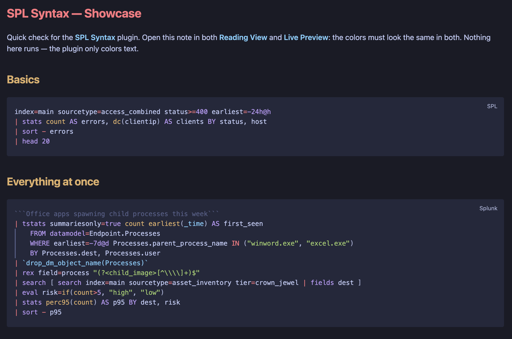

# SPL Syntax

**Splunk SPL syntax highlighting for Obsidian code blocks.**

Document investigations, detections, dashboards, and hunting hypotheses with readable SPL. SPL Syntax plugs into Obsidian's native code-block pipeline, so `spl` blocks behave exactly like built-in languages in Reading View, Live Preview, and source mode on desktop and mobile.



## Usage

```spl
index=main sourcetype=access_combined status>=400 earliest=-24h@h
| stats count AS errors BY status, host
| sort - errors
```

Use `spl` as the fenced-code language; ` ```splunk ` is an accepted alias. Blocks highlight through Obsidian's native code-block pipeline in both editing and reading modes: colorization stays active while you edit, the language flair copies the block ("Copied to your clipboard"), and colors come from your theme's code variables.

## Highlighted syntax

| Token | Examples |
| --- | --- |
| Generating commands | `search`, `tstats`, `from`, `inputlookup`, `makeresults` |
| Processing commands | `stats`, `eval`, `where`, `rex`, `timechart`, `lookup`, `streamstats` |
| Keywords | `AS`, `BY`, `OVER`, `WITH`, `OUTPUT`, `OUTPUTNEW` |
| Functions | `if`, `coalesce`, `strftime`, `cidrmatch`, `dc`, `perc95`, bare `count` |
| Word operators | `AND`, `OR`, `NOT`, `XOR`, `LIKE`, `IN` |
| Macros | `` `security_indexes` ``, `` `drop_dm_object_name(Processes)` `` |
| Internal fields | `_time`, `_raw`, `_indextime` |
| Strings and field references | `"GET /index.html"`, `'field with spaces'` |
| Comments | ```` ```only deltas``` ```` |
| Literals | `404`, `-24h@h`, `@d`, `+7d@w1`, `now` |
| Operators and brackets | `|`, `=`, `==`, `!=`, `[ ... ]` |

Plain search terms and field names stay unstyled on purpose, so a query reads as text instead of noise.

## Install

### Community plugins

After acceptance into the Obsidian Community directory, search for **SPL Syntax** under **Settings → Community plugins**.

### Manual installation

1. Download `main.js`, `manifest.json`, and `styles.css` from the latest matching GitHub release.
2. Create `<vault>/.obsidian/plugins/spl-syntax/`.
3. Copy all three files into that directory.
4. Enable **SPL Syntax** under **Settings → Community plugins**.

## Query templates

| File | Purpose |
| --- | --- |
| `templates/getting-started.spl` | Index and sourcetype filtering, aggregation, sorting |
| `templates/reporting.spl` | Time series with `timechart`, derived fields, rename |
| `templates/threat-hunting.spl` | Accelerated `tstats`, subsearch, macro, `rex`, `lookup` |

The plugin only highlights templates; it never executes them.

## Privacy and security

SPL Syntax runs locally. It makes no network requests, requires no account, reads no vault files, executes no queries, and includes no telemetry, analytics, advertisements, or payments. The plugin only registers language definitions with Obsidian's built-in highlighters; it never injects HTML or renders content itself.

## Development

From a clean checkout, run the release checks in this order:

```bash
npm ci
npm run build
npm test
npm run verify:release
```

The production build creates the ignored `main.js` release asset.

Note on dependencies: use `npm ci`. A from-scratch `npm install` crashes on npm 10.x with `Cannot read properties of null (reading 'edgesOut')` — an npm bug in peer-graph resolution, not a project problem. If you need to refresh the lockfile, run it under npm 12 (`npx --yes npm@12 install`).

## References

- [Understanding SPL syntax](https://help.splunk.com/en/splunk-cloud-platform/spl-search-reference/10.0.2503/introduction/understanding-spl-syntax)
- [Command quick reference](https://help.splunk.com/en/splunk-enterprise/search/spl-search-reference/10.6/quick-reference/command-quick-reference)
- [Commands by category](https://help.splunk.com/en/splunk-enterprise/search/spl-search-reference/10.6/quick-reference/commands-by-category)
- [Command types](https://help.splunk.com/en/splunk-enterprise/search/spl-search-reference/10.6/quick-reference/command-types)
- [SPL for SQL users](https://help.splunk.com/en/splunk-enterprise/search/spl-search-reference/10.6/quick-reference/splunk-spl-for-sql-users)
- [Evaluation functions](https://help.splunk.com/en/splunk-enterprise/search/spl-search-reference/10.6/evaluation-functions/evaluation-functions)
- [Statistical and charting functions](https://help.splunk.com/en/splunk-enterprise/search/spl-search-reference/10.6/statistical-and-charting-functions/statistical-and-charting-functions)
- [Splunk cheat sheet: query, SPL, regex, commands](https://www.splunk.com/en_us/blog/learn/splunk-cheat-sheet-query-spl-regex-commands.html)
- [StationX Splunk cheat sheet](https://www.stationx.net/splunk-cheat-sheet/)
- [Obsidian plugin submission](https://docs.obsidian.md/Plugins/Releasing/Submit%20your%20plugin)
- [Obsidian plugin self-review checklist](https://docs.obsidian.md/oo/plugin)

## License

MIT
